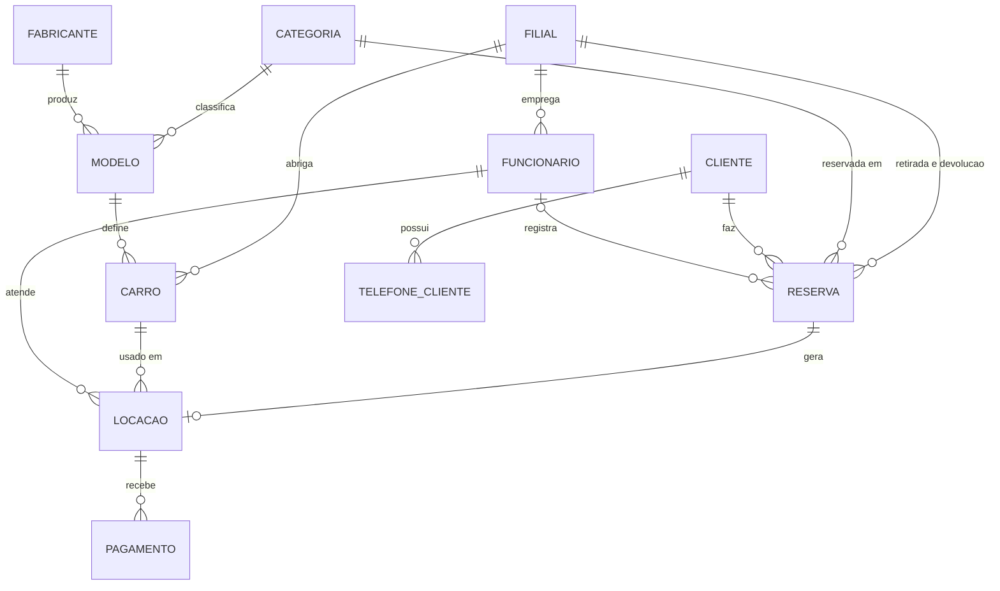

# Sistema de Reserva de Carros (MySQL)

Banco de dados relacional de uma locadora de veículos, criado com comandos DDL no trabalho individual da disciplina **Modelagem de Banco de Dados** (Engenharia de Software, 2º semestre de 2026). O modelo é baseado no estudo de caso da revista SQL Magazine, edição 74.

## Visão geral e contexto

Uma locadora precisa saber quais carros tem em cada filial, quem reservou o quê e quanto cada locação rendeu. Sem um modelo bem definido, esses dados ficam duplicados e inconsistentes.

Este projeto resolve isso com 11 tabelas ligadas por chaves estrangeiras, que cobrem o fluxo completo:

1. O cliente **reserva uma categoria** de carro para um período.
2. Na retirada, a reserva vira uma **locação** com um carro específico.
3. Na devolução, a locação registra a quilometragem final e recebe os **pagamentos**.

## Tecnologias utilizadas

- MySQL 8 (compatível com MariaDB)
- SQL (DDL)
- MySQL Workbench

## Como executar

Pré-requisito: MySQL 8 instalado.

> **Atenção:** o script começa com `DROP DATABASE IF EXISTS reserva_carros`. Se você já tiver um banco com esse nome, ele será apagado.

```bash
git clone https://github.com/borgesx07/sistema-reserva-carros-mysql.git
cd sistema-reserva-carros-mysql
mysql -u root -p < reserva_carros.sql
```

No MySQL Workbench: abra `reserva_carros.sql` em **File > Open SQL Script** e execute com **Ctrl+Shift+Enter**.

Para conferir o resultado:

```sql
USE reserva_carros;
SHOW TABLES;
DESCRIBE reserva;
```

## Demonstração visual

Diagrama entidade-relacionamento do banco:



Tabelas criadas pelo script:

```text
carro, categoria, cliente, fabricante, filial, funcionario,
locacao, modelo, pagamento, reserva, telefone_cliente
```

## Regras garantidas pelo banco

- A devolução precisa ser posterior à retirada (`CHECK`).
- A quilometragem de entrega não pode ser menor que a de retirada (`CHECK`).
- Cada reserva gera no máximo uma locação (`UNIQUE`).
- CPF, CNH e chassi não se repetem (`UNIQUE`).

## Licença

Distribuído sob a licença MIT. Veja o arquivo [LICENSE](LICENSE).
